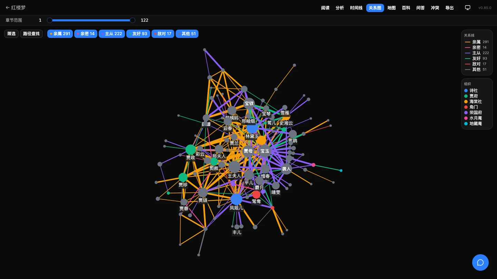
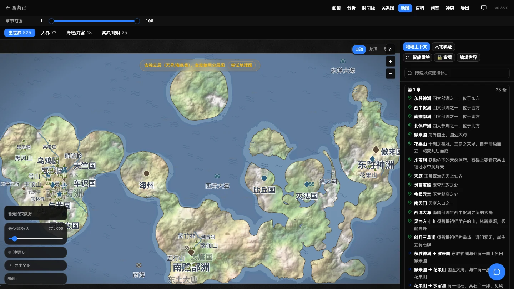
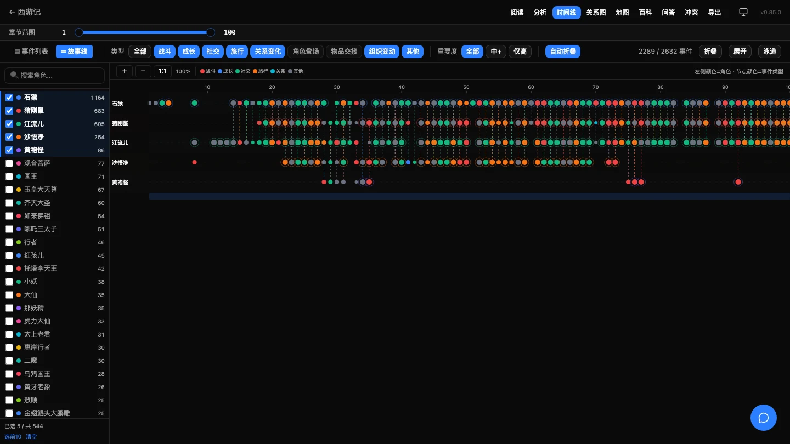
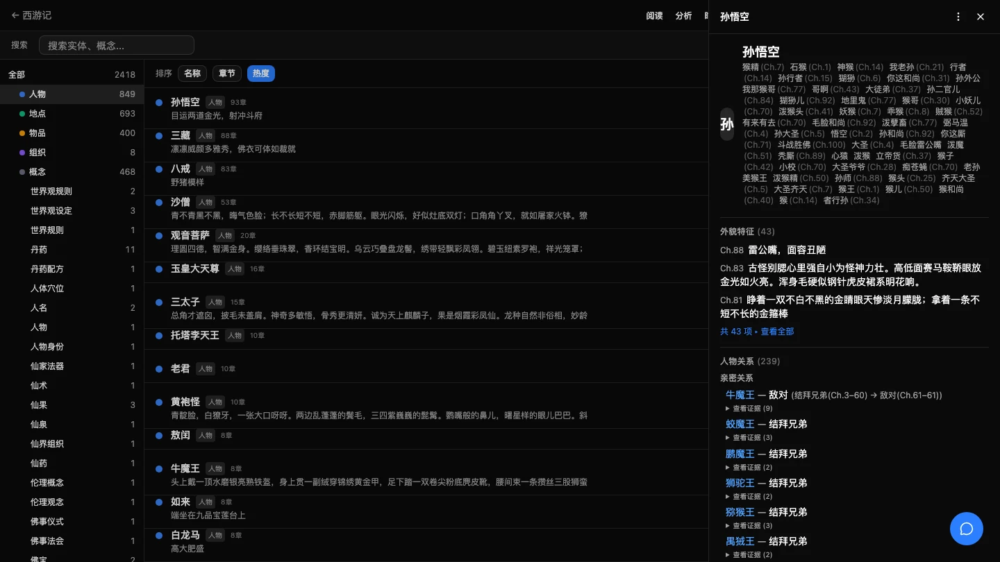

# AI Reader V2 — 把小说变成可探索的知识世界

[](https://github.com/mouseart2025/AI-Reader-V2/actions/workflows/test.yml)
[](https://github.com/mouseart2025/AI-Reader-V2/releases)
[](https://www.gnu.org/licenses/agpl-3.0)
[](https://github.com/mouseart2025/AI-Reader-V2)
[](https://www.python.org/)
[](https://nodejs.org/)
[](https://v2.tauri.app/)

> **[English Version](./README_EN.md)**

**上传一本小说，自动生成人物关系图、世界地图、时间线、百科和可溯源问答。**

AI Reader V2 不是让 LLM 写一篇读后感，而是把整本书拆成结构化的 `ChapterFact`：人物、关系、地点层级、物品流转、组织事件、时间线。然后把这些数据变成可以点、可以查、可以导出的交互式知识库。数据默认只存在本机。

> **当前状态（2026-10-27）**：**v0.85.0 已正式发布**，macOS（Apple Silicon）与 Windows x64 安装包已提供。项目仍在快速迭代，分析结果请结合原文核对，不建议直接作为学术结论。

<p align="center">
  <a href="https://ai-reader.cc"><strong>官网</strong></a> ·
  <a href="https://ai-reader.cc/demo/honglou/graph?v=3"><strong>在线 Demo</strong></a> ·
  <a href="#下载与安装"><strong>下载</strong></a> ·
  <a href="https://github.com/mouseart2025/AI-Reader-V2"><strong>源码</strong></a> ·
  <a href="./ROADMAP.md"><strong>路线图</strong></a>
</p>

## 目录

- [当前状态](#当前状态)
- [它是什么](#它是什么)
- [核心功能](#核心功能)
- [适合谁](#适合谁)
- [下载与安装](#下载与安装)
- [从源码运行](#从源码运行)
- [技术栈](#技术栈)
- [质量与可复现](#质量与可复现)
- [文档](#文档)
- [参与贡献](#参与贡献)
- [License](#license)

## 当前状态

| 渠道 | 版本 | 说明 |
|------|------|------|
| 桌面正式版 | **v0.85.0** | 推荐普通用户；macOS / Windows |
| 最新源码 | **v0.85.0** | 含地图可解释/切换与逐章成本耗时 |
| 在线 Demo | 红楼梦 / 西游记 | 免安装，浏览器直接看 |

- 源码与发布：<https://github.com/mouseart2025/AI-Reader-V2>
- v0.85.0 release：<https://github.com/mouseart2025/AI-Reader-V2/releases/tag/v0.85.0>
- 完整版本历史：[CHANGELOG.md](./CHANGELOG.md)

## 它是什么

大多数“AI 读小说”工具停在章节摘要。AI Reader V2 多做了一步：把摘要继续沉淀成**可计算的结构**。

- **结构化**：每章产出人物、关系、地点、物品、组织、事件、概念，跨章聚合成实体档案。
- **可解释**：关系带证据 span；地图会说明为什么用真实地理图或分层图；层级重建有快照和审计。
- **可修正**：别名合并/拆分、实体改名/隐藏/改类型，修正叠加在自动结果之上，不污染原文数据。
- **本地优先**：SQLite + ChromaDB 落在本机；可接本地 Ollama，也可接云端 OpenAI 兼容 API。

## 核心功能

### 🕸️ 人物关系知识图谱

力导向关系网络，自动识别 70+ 种关系类型，按血亲/亲密/师承/社交/敌对/其他六类着色。实体别名自动合并（孙悟空 = 美猴王 = 行者 = 齐天大圣），支持路径查找、分类过滤、边权重调节。



### 🗺️ 小说世界地图

从文本自动构建多层级地图：真实地理图（Leaflet + GeoNames）或天界/冥界/海底/秘境分层图。程序化地形、河流与大陆架、人物轨迹回放、rough.js 手绘风格。

v0.84 起，地图不再“静默回退”：接口返回 `layout_reason` / `geo_coverage`，界面提供**自动 / 地理 / 层级**切换，回退时说明原因；现实题材的“海底”层不会再被误判成整本幻想地图。



### ⏳ 多泳道时间线

多源事件聚合（角色登场、物品流转、关系变迁、组织变动），智能降噪、情绪基调标签、章节自动折叠；故事线泳道追踪多角色并行叙事。



### 📖 小说百科全书

人物/地点/物品/组织/概念五类实体，地点层级树与空间关系面板，场景索引定位原文，世界观总览。



### 更多能力

| 能力 | 说明 |
|------|------|
| 🖥️ 桌面应用 | Tauri 2 原生客户端，内置 Python sidecar，下载即用 |
| 📚 书架管理 | 拖拽上传 `.txt` / `.md`，50+ 章节格式，搜索排序，导入/导出/备份 |
| 🔍 实体预扫描 | jieba 分词 + LLM 分类，生成实体词典提升抽取质量 |
| 📖 智能阅读 | 实体高亮、别名解析、书签、划线批注、场景/剧本面板 |
| ⚔️ 势力图 | 组织架构与势力关系网络 |
| 💬 RAG 问答 | 基于原文的检索增强问答，流式输出，答案可溯源 |
| 📤 设定集导出 | Markdown / Word / Excel / PDF，支持模板与章节范围 |
| 🤖 多 LLM | 本地 Ollama + 10 家云端 OpenAI 兼容供应商 |
| 🔁 独立二审 | 分析后可选二次独立重读，逐章对照分歧，成本单独分账 |
| 💰 成本/耗时 | 每章 token、费用、耗时与总量汇总，支持 CSV |
| 🛠️ 人工修正 | 别名合并/拆分、实体改名/隐藏/改类型，可撤销 |
| 🧪 可复现 | 1764 个后端测试、112 个前端测试，金标回归与 CI |

## 适合谁

| 场景 | 能做什么 |
|------|----------|
| 网文/小说世界观整理 | 自动梳理人物关系、地点层级、势力分布 |
| 文学研究 | 角色网络、叙事结构、空间层级的可视化探索 |
| 创作辅助 | 设定集导出、世界观一致性检查、角色关系梳理 |
| 同人/二创 | 快速了解原著角色关系和世界观 |
| 读书笔记 | 阅读中高亮、批注、书签、场景索引 |
| 教学演示 | 用一张图讲清复杂人物关系和空间结构 |

## 下载与安装

桌面版内置 Python 后端，无需配置开发环境；只需安装 [Ollama](https://ollama.com/) 或配置云端 API。

| 平台 | 稳定版下载 | 架构 |
|------|------------|------|
| macOS | [AI Reader 0.85.0 (dmg)](https://github.com/mouseart2025/AI-Reader-V2/releases/download/v0.85.0/AI.Reader_0.85.0_aarch64.dmg) | Apple Silicon (M1/M2/M3/M4) |
| Windows | [AI Reader 0.85.0 (exe)](https://github.com/mouseart2025/AI-Reader-V2/releases/download/v0.85.0/AI.Reader_0.85.0_x64-setup.exe) | x86_64 |

> **安装包说明**：当前构建为 ad-hoc / 未签名（签名 secrets 尚未迁移到公开仓）。macOS 首次打开可能提示“已损坏”，按下方命令处理后重开；Windows SmartScreen 可能提示未知发布者，选择“更多信息 → 仍要运行”。
>
> 校验文件：[SHA256SUMS.txt](https://github.com/mouseart2025/AI-Reader-V2/releases/download/v0.85.0/SHA256SUMS.txt)。

<details>
<summary>macOS 首次打开提示“已损坏”？</summary>

在终端运行：

```bash
xattr -cr "/Applications/AI Reader.app"
```

然后重新打开。
</details>

更多版本与 Pre-release：[Releases](https://github.com/mouseart2025/AI-Reader-V2/releases)。

## 从源码运行

**环境要求：** Python 3.10+、Node.js 22+、[uv](https://docs.astral.sh/uv/)、[Ollama](https://ollama.com/)（或云端 API）。

```bash
# 1. 克隆
git clone https://github.com/mouseart2025/AI-Reader-V2.git
cd AI-Reader-V2

# 2. 后端（--all-extras 含语义搜索重依赖；只跑基础功能可去掉）
cd backend
uv sync --all-extras
uv run uvicorn src.api.main:app --reload

# 3. 前端（新终端）
cd frontend
npm install
npm run dev
```

打开 <http://localhost:5173>，上传 TXT/Markdown → 开始分析 → 查看图谱/地图/时间线/百科。

- **本地模型**：`ollama pull qwen3:8b && ollama serve`，在设置页选择 Ollama。
- **云端模型**：设置页填 API Key / Base URL / 模型名，支持 DeepSeek、MiniMax、Claude、OpenAI、Gemini 等。
- **不想部署**：直接看 [在线 Demo](https://ai-reader.cc/demo/honglou/graph?v=3)。

桌面端构建、测试与开发约定见 [CONTRIBUTING.md](./CONTRIBUTING.md)。

## 技术栈

| 层 | 技术 |
|----|------|
| 前端 | React 19 + TypeScript 5.9 + Vite 8 + Tailwind CSS 4 + shadcn/ui |
| 桌面 | Tauri 2（Rust）+ Python sidecar（PyInstaller） |
| 可视化 | react-force-graph-2d（图谱）/ Leaflet（地理）/ D3 + SVG（地图、时间线） |
| 状态 | Zustand 5 |
| 后端 | Python + FastAPI（async）+ aiosqlite |
| 数据 | SQLite（结构化）+ ChromaDB（向量检索） |
| LLM | Ollama（本地）或 OpenAI 兼容 API（云端，10 家供应商） |
| 中文 NLP | jieba 分词 + 实体预扫描 |

## 质量与可复现

- **测试**：1764 个后端测试、112 个前端测试；CI 跑 ruff / eslint / pytest / vitest / build / 仓库边界。
- **金标**：西游记、红楼梦、水浒、三国、封神的地名层级与人物审阅数据在 `backend/data/review/` 与 `backend/data/hierarchy_validation/`，作为回归夹具。
- **地图审计**：`backend/scripts/map_quality_audit.py` 可逐本输出地图模式、回退原因、geo 覆盖率。
- **质量循环**：`backend/scripts/quality_loop.py` 聚合 Q0/judge/关系维度/冒烟产物，硬回归会非零退出。

```bash
cd backend && uv run pytest tests/ -q
cd frontend && npx vitest run && npm run build
```

更多口径见 [CLAUDE.md](./CLAUDE.md) 与 [ROADMAP.md](./ROADMAP.md)。

## 文档

- 📋 [贡献指南](./CONTRIBUTING.md) — 开发环境、代码规范、PR 流程
- 🏗️ [技术架构](./CLAUDE.md) — 管线、数据模型、代码约定
- 🗺️ [路线图](./ROADMAP.md) — 当前版本与后续计划
- 📝 [更新日志](./CHANGELOG.md) — 完整版本历史
- 🔐 [安全策略](./SECURITY.md) — 漏洞报告与安全边界
- 💼 [商业许可](./LICENSE-COMMERCIAL.md) — 商业使用条款
- 📄 [第三方声明](./NOTICE) — GeoNames / 维基 / 依赖许可
- ✍️ [开发故事](https://zhuanlan.zhihu.com/p/2016598051163218226) — 从零到一的完整开发历程

## 参与贡献

- 有 Bug 或功能建议：开 [Issue](https://github.com/mouseart2025/AI-Reader-V2/issues/new/choose)。
- 想讨论用法/设计：开 [Discussion](https://github.com/mouseart2025/AI-Reader-V2/discussions)。
- 提交代码前请先读 [CONTRIBUTING.md](./CONTRIBUTING.md)，并遵守 [CODE_OF_CONDUCT.md](./CODE_OF_CONDUCT.md)。

如果这个项目对你有帮助，欢迎点一个 ⭐，这是对维护者最直接的鼓励。

## License

[GNU Affero General Public License v3.0](./LICENSE)（AGPL-3.0）。

个人、教育和研究用途免费；商业闭源部署请参阅 [商业许可](./LICENSE-COMMERCIAL.md)。源码公开，欢迎 fork 和 PR。

---

**关键词：** 小说分析工具 / 网文分析 / AI 阅读器 / 知识图谱生成 / 人物关系图 / 小说世界地图 / 时间线可视化 / NLP 文本分析 / LLM 应用 / Ollama / 中文小说 / 网络小说工具 / 角色关系梳理 / 世界观整理 / novel analysis / knowledge graph / character relationship
